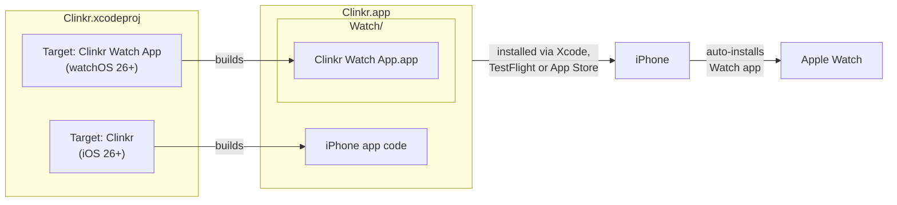
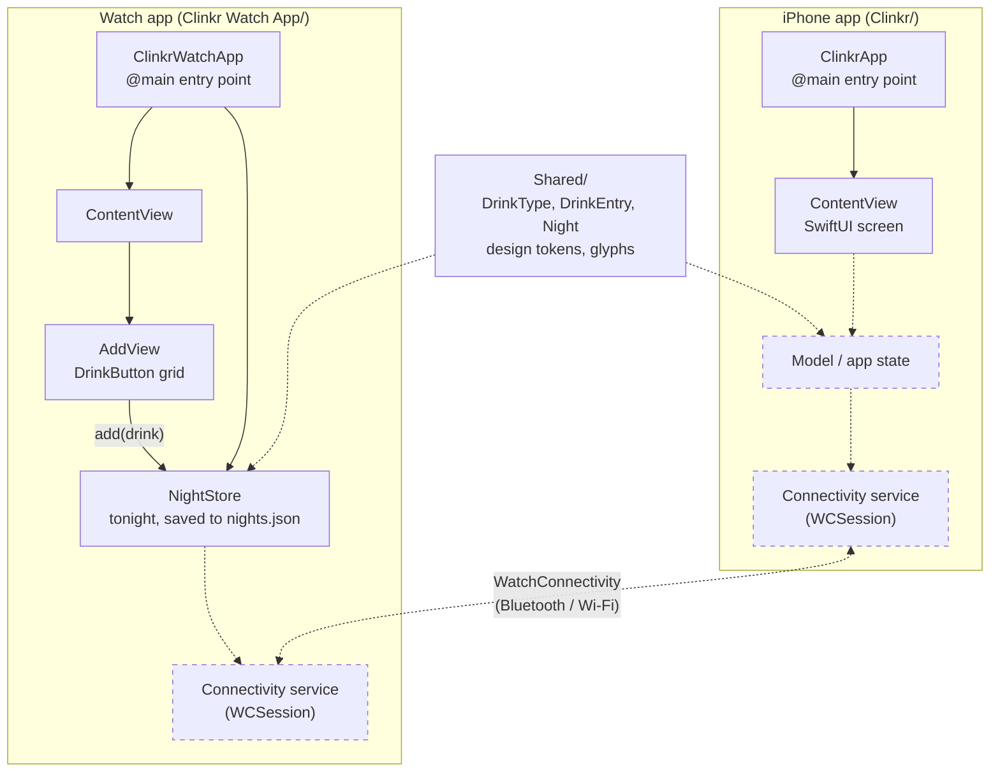
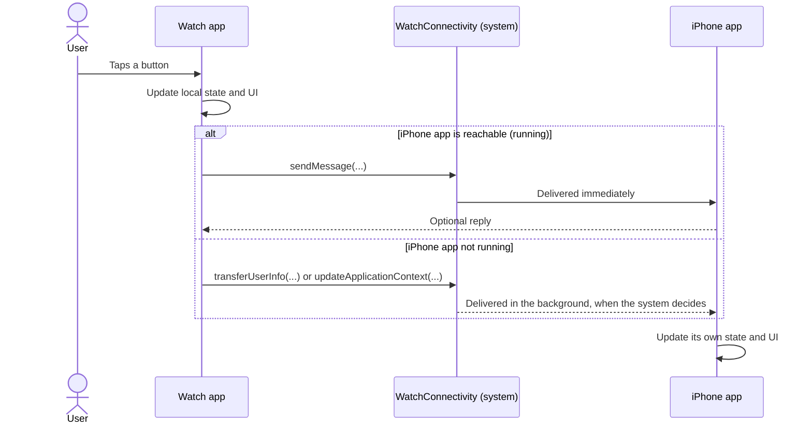

# Clinkr architecture

How the iPhone app and the Apple Watch app fit together. Solid lines are what exists today. Dashed boxes and lines are the usual next pieces, which aren't built yet.

## 1. From project to devices

One Xcode project builds two apps. The Watch app is packed inside the iPhone app, and the Watch installs it automatically when the iPhone app is installed.

## 2. Inside each app

Both apps are SwiftUI apps with the same shape. Each one starts at an `@main` App struct, which shows a `ContentView`. Both compile `Shared/`: the data model (`DrinkType`, `DrinkEntry`, `Night`) and the design system (colors, text styles, spacing, radii and drink glyphs). The Watch keeps tonight in `NightStore`, which the Add screen's drink buttons write to. The iPhone's own state and phone/watch messaging come later.

## 3. How a message would travel between Watch and iPhone

This is the usual pattern with Apple's WatchConnectivity framework. If the other app is running, messages arrive right away. If not, the system queues the data and delivers it later.

